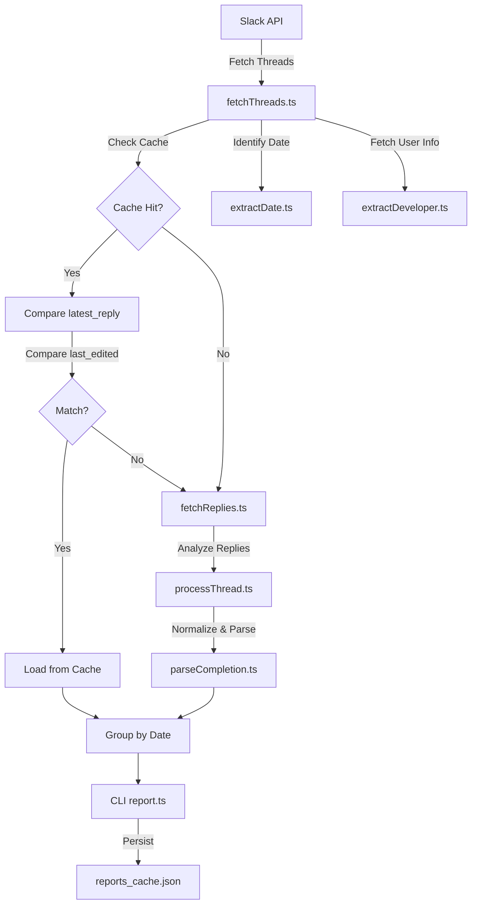

# 📄 Product Requirements Document (PRD)

## 📌 Project Title
**Slack Sprint Bot**

---

## 🎯 Objective
Automate the extraction and summarization of Weekly Sprint completion data from Slack threads. The tool identifies threads created by Slack Workflows, extracts developer names via user mentions, parses completion percentages from CEO summaries, and generates a grouped historical report with local performance caching.

---

## 🧩 Problem Statement
* Sprint updates are scattered across multiple Slack Workflow threads.
* Manual extraction of completion data is error-prone and time-consuming.
* No easy way to view historical performance across different sprint weeks.
* Repeatedly fetching data from Slack API for older, unchanged threads is inefficient.

---

## ✅ Solution
A TypeScript-based CLI tool that:
1. **Fetches Workflow Threads**: Scans the channel for "Weekly Sprint" logs.
2. **Identifies Developers**: Resolves Slack user mentions (e.g., `<@U12345>`) to real names.
3. **Parses Completion**: Robustly extracts percentages from CEO summaries, handling Slack formatting (bullets, bolding).
4. **Groups by Date**: Organizes reports by sprint date (YYYY-MM-DD).
5. **Caches Results**: Uses a local JSON cache (`src/data/reports_cache.json`) to skip re-processing of unchanged threads.
6. **Filters History**: Displays all sprints occurring after a configurable date (Current: `2026-03-17`).

---

## 📊 Data Source & Structure
* **Platform**: Slack (Check-in Channel).
* **Thread Creator**: Slack Workflow.
* **Thread Title**: `Weekly Sprint (YYYY-MM-DD) Log – Thread for @UserMention`.
* **Summary Message**: CEO posts a `SPRINT_CLOSING` summary in the replies.

---

## 🧾 Message Template (Source of Truth)
Extracts data from messages following this pattern:
```text
• Completion: 100%
• Carryover: None
• Remarks: ...
```

---

## 🏗️ Project Architecture



---

## 🎯 Technical Features
| Feature | Details |
| :--- | :--- |
| **User Resolution** | Uses `users.info` to convert `<@ID>` into "Real Name". |
| **Caching** | Tracks `latest_reply` timestamp to detect thread updates. |
| **Edit Detection** | Tracks Slack message edits using `edited.ts` across all replies. |
| **Enhanced Validation** | Combines reply + edit timestamps for robust cache invalidation. |
| **Normalization** | Handles en-dash, em-dash, and Slack markdown gracefully. |
| **Grouping** | Aggregates results into sprint buckets (YYYY-MM-DD). |

---

## 📤 Output Format
```text
========================================
📅 Sprint: 2026-03-24
========================================

Total Developers: 6
Reported: 4 | Missing: 2

┌─────────────────┬──────────────┬───────────────┐
│ Developer       │ Completion   │ Status        │
├─────────────────┼──────────────┼───────────────┤
│ Tejas           │ 100%         │ ✅ Done       │
│ Santu Mahapatra │ --           │ ❌ No Report  │
└─────────────────┴──────────────┴───────────────┘
```

---

## 🛠️ Tech Stack
* **Language**: TypeScript
* **Runtime**: Node.js
* **API**: @slack/web-api
* **Persistence**: Local JSON
* **Config**: Dotenv

---

## ⚡ Caching & Optimization
* Cache now tracks both:
  * `latest_reply` (new messages)
  * `last_edited` (message edits)
* **Ensures detection of:**
  * New replies ✅
  * Edited messages ✅
* **Recent Thread Refresh**: The **latest 2 sprint dates** are always reprocessed (skipping cache) to ensure all threads within active sprints are always accurate.
* Prevents stale sprint reports due to message modifications.

---

## 🧠 Limitations / Future Scope
* **Deletion Detection**: Currently limited; if a message is deleted, Slack does not update `latest_reply`.
* **Content Hashing**: Possible future improvement to detect changes that don't trigger `edited.ts`.
* **Rate Limiting**: Potential for performance impact if many threads require full refresh.
